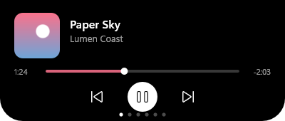
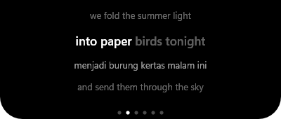
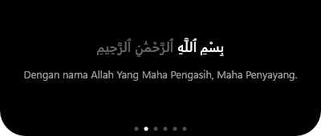
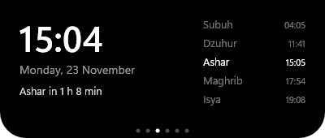
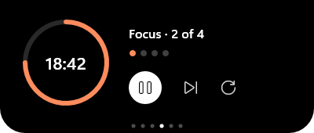
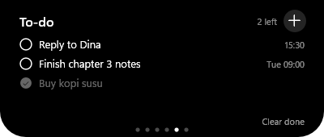

<p align="center"></p>

<h1 align="center">notch</h1>

<p align="center">
  A light, springy notch for the top of your Windows screen.<br>
  Music and synced lyrics, pop-ups, prayer times, a focus timer, to-do, Jot and a file shelf.<br>
  About 5–10 MB of memory and no CPU at all while nothing happens.
</p>

<p align="center"></p>

It sits at the top center of your main screen as a small black pill. Hover it to peek, click it to keep it open, and
swipe between pages. It hides while a full-screen app or video is in front.

## What's inside

**Music from any player.** Whatever shows in Windows' volume flyout: Spotify, a browser, Qistara and the rest. Cover,
title, seek bar, play/pause, previous and next. While music plays, the closed pill shows the cover and the line being
sung, and resizes to fit it.

<p></p>

**Synced lyrics.** Looked up on [LRCLIB](https://lrclib.net) and kept on your PC. Click a line to jump there. With
[Qistara](https://github.com/Schongli/Qistara), the notch shows Qistara's own lyrics instead: word by word, with the
translation under each line, and the ayahs of a Qur'an recitation in Arabic with their translation.

<p>
  
  
</p>

**Pop-ups.** Volume (scroll on the closed pill to change it), Caps Lock, switching speakers or headphones, plugging in
the charger, and a low battery. The pill springs wider to fit them and back.

<p></p>

**Clock and prayer times.** Calculated on your PC from your coordinates, with the Kemenag angles and ihtiyat by
default. The next prayer is highlighted, the closed pill counts down the last 30 minutes, and your music can pause
itself when it's time.

<p></p>

**Focus timer.** Focus, short break and long break rounds in a ring. The closed pill shows the minutes left.

<p>
  
  
</p>

**To-do and Jot.** Type `Reply to Dina 15:30` and you're reminded at 15:30. `Ctrl+Alt+J` opens a box from anywhere and
adds what you type, with the date and time, to a Markdown file of your choice (an Obsidian inbox works well).

<p></p>

**Shelf.** Drag files onto the notch to keep them close, then drag them out into a chat, an email or a folder. The
shelf only remembers where each file is: it never copies or moves anything, and dragging a file out never moves the
original.

<p></p>

## Using it

| Do this | And |
|---|---|
| Hover the pill | It opens; move away and it closes |
| Click it, or press `Ctrl+Alt+N` | It stays open: `←` `→` change pages, `Space` plays or pauses, `Esc` closes |
| Drag down on it, or flick up | Open, or close |
| Swipe sideways (two fingers, or drag), or click the dots | Change pages |
| Scroll on the closed pill | Volume up or down |
| `Ctrl+Alt+J` | Jot an idea |
| Drag files onto the pill | Add them to the shelf |
| Right-click the tray icon | Start with Windows, Edit settings…, Exit |

## Install

1. Download `notch-vX.Y.Z-x64.zip` from [Releases](../../releases) and unzip it anywhere.
2. Run `notch.exe`. Tray icon → **Start with Windows** to keep it.

Needs 64-bit Windows 10 (1809 or later) or Windows 11. No installer and no admin rights.

The exe isn't code-signed yet, so Windows shows **"Windows protected your PC"**: choose **More info → Run anyway**.
To check you have the real file, compare its hash with `SHA256SUMS.txt` from the same release:

```powershell
Get-FileHash .\notch.exe -Algorithm SHA256
```

To remove it: untick Start with Windows, choose Exit, then delete the folder, `%APPDATA%\notch` and `%LOCALAPPDATA%\notch`.

## Settings

Tray icon → **Edit settings…** opens `%APPDATA%\notch\config.toml`. Save it and the notch changes right away; a typo
is explained inside the notch. Delete a line to go back to its default, or delete the file to get a fresh one with
every option explained.

```toml
hotkey = "Ctrl+Alt+N"

[theme]            # your skin
background = "#000000"
text = "#FFFFFF"
open_width = 400

[prayer]           # leave 0, 0 to hide prayer times
latitude = -6.2
longitude = 106.8
names = ["Subuh", "Dzuhur", "Ashar", "Maghrib", "Isya"]
pause_music = true

[jot]
hotkey = "Ctrl+Alt+J"
file = "%USERPROFILE%\\Documents\\Jot.md"
```

## Privacy

There are no accounts, no analytics and no servers of its own. The one request it makes:

| Service | When | What is sent |
|---|---|---|
| [LRCLIB](https://lrclib.net) | a song has no lyrics in the local cache (and Qistara has none for it) | title, artist, album, length |

Everything else stays on your PC: settings (`%APPDATA%\notch\config.toml`), tasks (`todo.json`), the shelf
(`shelf.json`, paths only), the lyrics cache and `crash.log` (`%LOCALAPPDATA%\notch`), and your Jot file.
Prayer times are calculated locally.

- **Caps Lock** needs a low-level keyboard hook. It looks only at the Caps Lock key; every other key passes straight
  through, unread, and nothing is stored.
- **Music**: it reads what Windows' media controls show. No audio is captured.
- **Qistara**: it reads `%LOCALAPPDATA%\com.qistara.app\notch\now-lyrics.json`, a local file Qistara writes.

## Light on your PC

Measured in Task Manager ("Memory"): about 5–10 MB, and 0% CPU while idle, music playing included. The exe is under
1 MB. It's plain Win32 and Direct2D in Rust: no web view, no GUI framework, no async runtime. Frames are drawn only
while something moves, and every update (music, volume, power, files) comes from Windows as an event; nothing polls.

## Known limits

- Not code-signed (see Install).
- Shows on the main screen only.
- Screen readers can't read it yet: it draws its own interface.
- Reading Windows notifications needs a packaged (Store) app, so there are none.

## Build from source

Install [Rust](https://rustup.rs) (stable, MSVC), then:

```powershell
cargo build --release
```

The app is `target\release\notch.exe`. `cargo test` runs the unit tests; `cargo test -- --ignored` also runs the ones
that talk to lrclib.net or the Windows shell, and draws every page to `%TEMP%\notch-pages`.

## Credits

- Inspired by [Nusa](https://rama2555.github.io/nusa/) by Rama. notch is a separate project, not affiliated.
- Prayer times by [salah](https://crates.io/crates/salah) (MIT), lyrics from [LRCLIB](https://lrclib.net), Windows APIs
  through [windows-rs](https://github.com/microsoft/windows-rs) (MIT/Apache-2.0).
- Icons are Segoe Fluent Icons / Segoe MDL2 Assets, part of Windows (not bundled).

## License

MIT © 2026 Schongli
