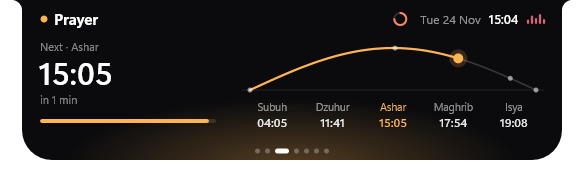
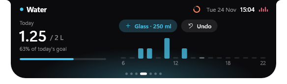
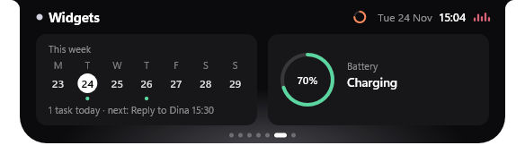
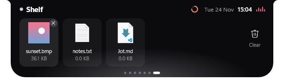

<p align="center"></p>

<h1 align="center">notch</h1>

<p align="center">
  A light, springy notch for the top of your Windows screen.<br>
  Music and synced lyrics, focus, prayer times, water, to-do, widgets, a file shelf, and two eyes that rest when you do.<br>
  About 6 MB of memory and no CPU at all while nothing happens.
</p>

<p align="center"></p>

It sits at the top center of your main screen as a small black pill, about as tall as a title bar's text, or as a thin
line if you prefer. Rest the pointer on it and it opens (passing over it on your way to a tab doesn't count), click it
to keep it open, and swipe between pages. It hides while a full-screen app or video is in front.

## The closed notch

While something is going on, the closed notch shows it in three small slots and stays out of the way:

<p>
  
  
  
</p>

A running focus timer comes first, then music, then a prayer in the next half hour. When nothing has happened for a
minute, the clock gives way to two eyes. They blink now and then, doze off when you've been away for a few minutes, and
wake up with a little hop when you're back.

<p></p>

Pop-ups grow out of it and settle back: volume (scroll on the closed notch to change it), Caps Lock, switching
speakers or headphones, the charger, a low battery, task reminders, prayer times and water.

<p>
  
  
</p>

## Pages

Every page has the same header: what it is, the date and time, a small focus ring while a timer runs and bars while
music plays. Move the pointer to a side for ‹ › arrows, or swipe.

**Music from any player.** Whatever shows in Windows' volume flyout: Spotify, a browser, Qistara and the rest.

**Synced lyrics.** Looked up on [LRCLIB](https://lrclib.net) and kept on your PC; the list button next to the controls
shows or hides them. Click a line to jump there. With [Qistara](https://github.com/Schongli/Qistara), the notch shows
Qistara's own lyrics instead: word by word, with the translation under each line, and the ayahs of a Qur'an recitation
in Arabic with their translation.

<p>
  
  
</p>

**Focus.** Focus, short break and long break rounds, with the rounds as a track and today's focused time underneath.

<p></p>

**Prayer times.** Calculated on your PC from your coordinates, with the Kemenag angles and ihtiyat by default. The day
is drawn as an arc from Fajr to Isha with the sun where you are on it. Your music can pause itself when it's time.

<p></p>

**Water.** A daily goal, a button for each glass, the day by the hour, and a gentle nudge only when you fall behind
your pace during your hours.

<p></p>

**To-do and Jot.** Type `Reply to Dina 15:30` and you're reminded at 15:30. `Ctrl+Alt+J` opens a box from anywhere and
adds what you type, with the date and time, to a Markdown file of your choice (an Obsidian inbox works well).

<p></p>

**Widgets.** Two cards of your choice: this week (with dots on days a task is due), battery, the next prayer, water
or focus.

<p></p>

**Shelf.** Drag files onto the notch to keep them close, then drag them out into a chat, an email or a folder. The
shelf only remembers where each file is: it never copies or moves anything, and dragging a file out never moves the
original.

<p></p>

## Using it

| Do this | And |
|---|---|
| Rest the pointer on the notch | It opens; move away and it closes |
| Click it, or press `Ctrl+Alt+N` | It stays open: `←` `→` change pages, `↑` `↓` scroll, `Space` plays or pauses, `Esc` closes |
| Drag down on it, or flick up | Open, or close |
| Swipe sideways (two fingers, or drag), click the dots or the side arrows | Change pages |
| Scroll on the closed notch | Volume up or down |
| Scroll on the open To-do or Shelf | Scroll the list |
| `Ctrl+Alt+J` | Jot an idea |
| Drag files onto the notch | Add them to the shelf |
| Right-click the tray icon | Start with Windows, Edit settings…, Exit |

## Install

1. Download `notch-vX.Y.Z-x64.zip` from [Releases](../../releases) and unzip it anywhere.
2. Run `notch.exe`. Tray icon → **Start with Windows** to keep it.

Needs 64-bit Windows 10 (1809 or later) or Windows 11. No installer and no admin rights.

The exe isn't code-signed yet, so Windows shows **"Windows protected your PC"**: choose **More info → Run anyway**.
To check you have the real file, compare its hash with `SHA256SUMS.txt` from the same release:

```powershell
Get-FileHash .\notch.exe -Algorithm SHA256
```

To remove it: untick Start with Windows, choose Exit, then delete the folder, `%APPDATA%\notch` and `%LOCALAPPDATA%\notch`.

## Settings

Tray icon → **Edit settings…** opens `%APPDATA%\notch\config.toml`. Save it and the notch changes right away; a typo
is explained inside the notch. Delete a line to go back to its default, or delete the file to get a fresh one with
every option explained.

```toml
hotkey = "Ctrl+Alt+N"

[theme]            # your skin
style = "pill"     # or "line": a thin line while nothing is happening
background = "#0B0B0D"
open_width = 540

[music]
lyrics_in_pill = false   # true: the line being sung in the closed notch

[prayer]           # leave 0, 0 to hide prayer times
latitude = -6.2
longitude = 106.8
names = ["Subuh", "Dzuhur", "Ashar", "Maghrib", "Isya"]
pause_music = true

[water]
goal_ml = 2000
glass_ml = 250
start = "08:00"
end = "22:00"
remind_every = 60  # minutes; 0 for no nudges

[widgets]          # week, battery, prayer, water or focus
left = "week"
right = "battery"

[eyes]
after = 60         # seconds of quiet; 0 turns them off

[jot]
hotkey = "Ctrl+Alt+J"
file = "%USERPROFILE%\\Documents\\Jot.md"
```

Coming from 0.1? Sizes you never changed move to the new defaults on their own.

## Privacy

There are no accounts, no analytics and no servers of its own. The one request it makes:

| Service | When | What is sent |
|---|---|---|
| [LRCLIB](https://lrclib.net) | a song has no lyrics in the local cache (and Qistara has none for it) | title, artist, album, length |

Everything else stays on your PC: settings (`%APPDATA%\notch\config.toml`), tasks (`todo.json`), water
(`water.json`), today's focus time (`focus.json`), the shelf (`shelf.json`, paths only), the lyrics cache and
`crash.log` (`%LOCALAPPDATA%\notch`), and your Jot file. Prayer times are calculated locally.

- **Caps Lock** needs a low-level keyboard hook. It looks only at the Caps Lock key; every other key passes straight
  through, unread, and nothing is stored.
- **The eyes** ask Windows how long since the last key or mouse input (one number, every few seconds, only while
  they're out). Nothing about what you type or click.
- **Music**: it reads what Windows' media controls show. No audio is captured.
- **Qistara**: it reads `%LOCALAPPDATA%\com.qistara.app\notch\now-lyrics.json`, a local file Qistara writes.

## Light on your PC

Measured in Task Manager ("Memory"): about 6 MB, and 0% CPU while idle, music playing included. The exe is about
1 MB. It's plain Win32 and Direct2D in Rust: no web view, no GUI framework, no async runtime. Frames are drawn only
while something moves (opening, a page turning, a blink), and every update (music, volume, power, files) comes from
Windows as an event; nothing polls.

## Known limits

- Not code-signed (see Install).
- Shows on the main screen only.
- Screen readers can't read it yet: it draws its own interface.
- Reading Windows notifications needs a packaged (Store) app, so there are none.

## Build from source

Install [Rust](https://rustup.rs) (stable, MSVC), then:

```powershell
cargo build --release
```

The app is `target\release\notch.exe`. `cargo test` runs the unit tests; `cargo test -- --ignored` also runs the ones
that talk to lrclib.net or the Windows shell, and draws every page and closed state to `%TEMP%\notch-pages`.

## Credits

- Inspired by [Nusa](https://rama2555.github.io/nusa/) by Rama. notch is a separate project, not affiliated, with its
  own design.
- Prayer times by [salah](https://crates.io/crates/salah) (MIT), lyrics from [LRCLIB](https://lrclib.net), Windows APIs
  through [windows-rs](https://github.com/microsoft/windows-rs) (MIT/Apache-2.0).
- Icons are Segoe Fluent Icons / Segoe MDL2 Assets, part of Windows (not bundled).

## License

MIT © 2026 Schongli
